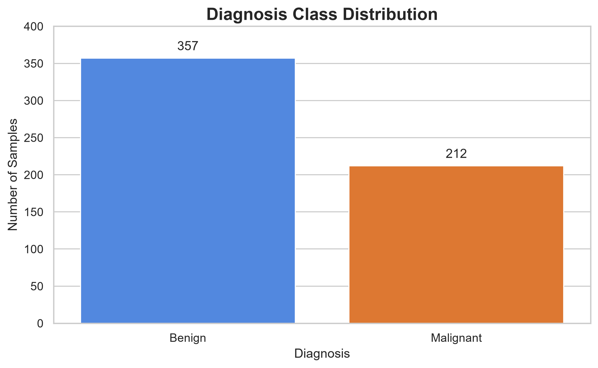
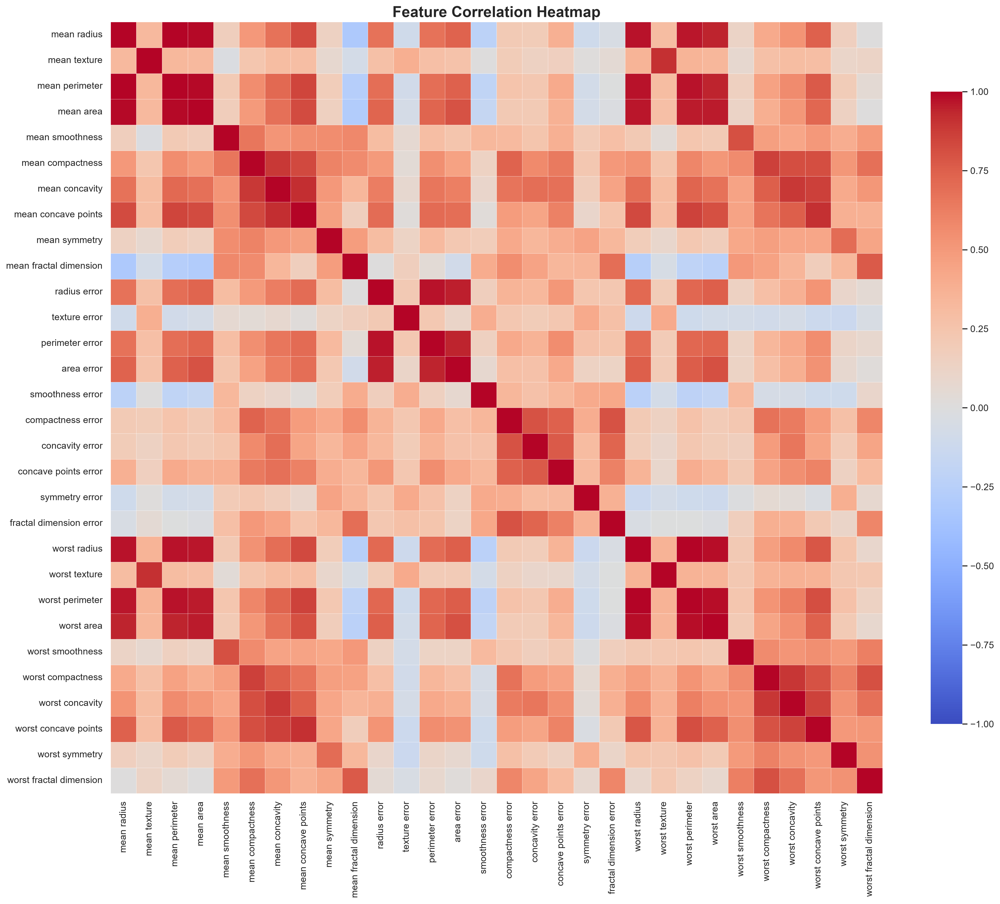
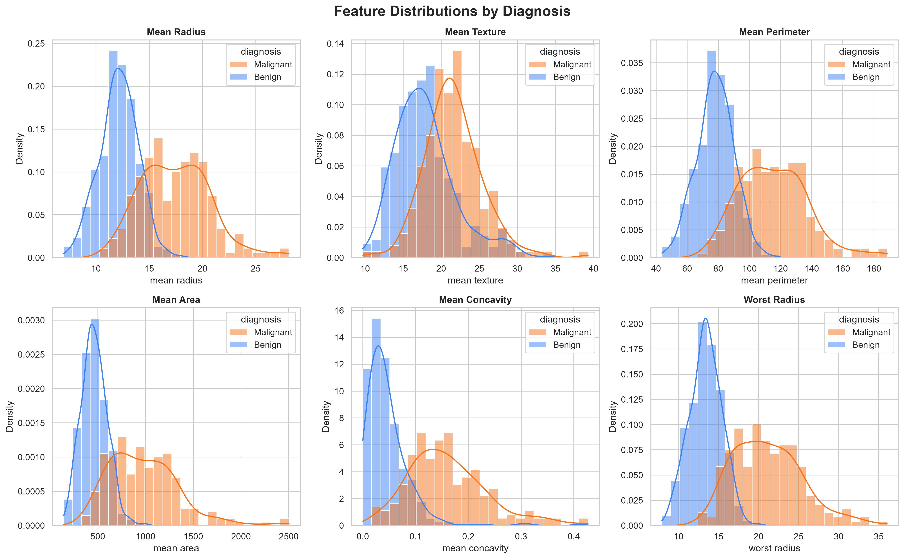
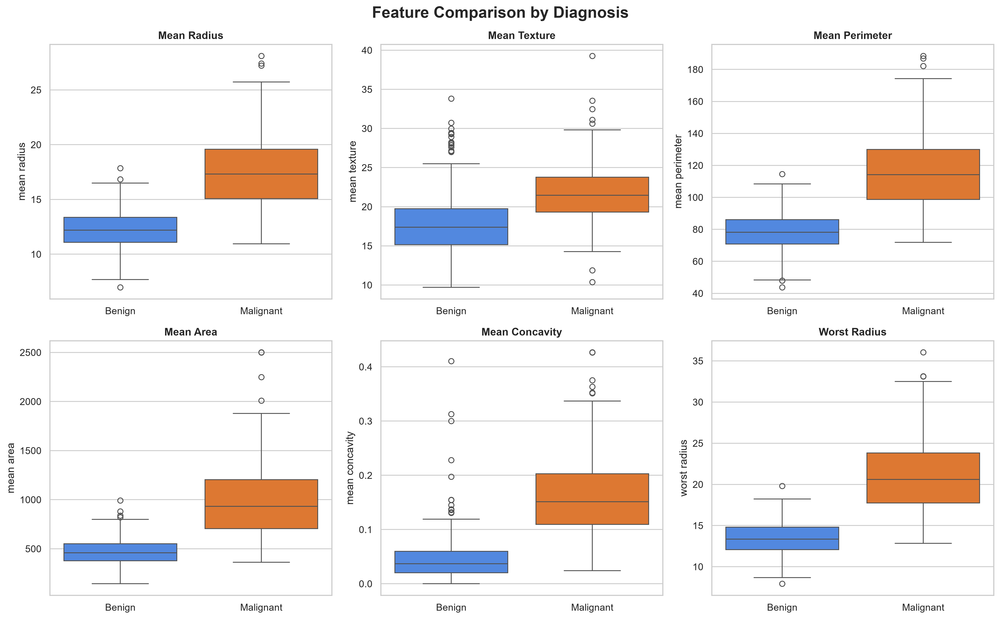
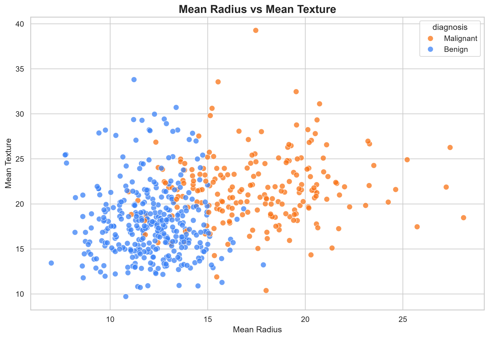
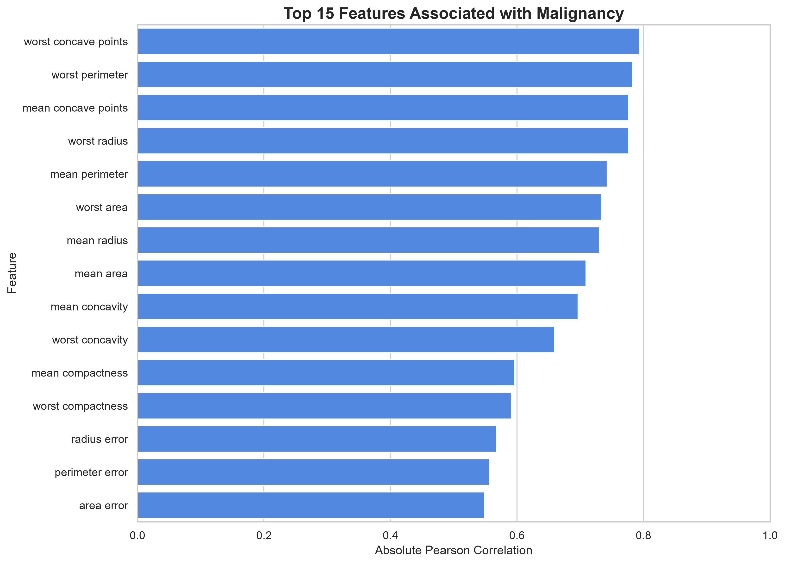

# Breast Cancer Classification & XAI

A simple machine learning project that uses Logistic Regression to classify breast cancer samples as benign or malignant using the Wisconsin Diagnostic Breast Cancer dataset.

## Project Objective

The objective is to understand supervised machine learning, data preprocessing, binary classification, and model evaluation through a practical Python project.

## Dataset

The dataset is provided by scikit-learn.

| Property          | Value |
| ----------------- | ----: |
| Total samples     |   569 |
| Input features    |    30 |
| Benign samples    |   357 |
| Malignant samples |   212 |
| Missing values    |     0 |

The features represent numerical measurements of cell nuclei, including radius, texture, perimeter, area, and smoothness.

## Technologies Used

- Python
- Pandas
- NumPy
- scikit-learn
- Matplotlib
- Seaborn
- Joblib

## Methodology

1. Load and inspect the dataset.
2. Perform exploratory data analysis.
3. Separate input features and target labels.
4. Split the dataset into 80% training and 20% testing data.
5. Apply feature scaling using StandardScaler.
6. Train a Logistic Regression model.
7. Evaluate predictions on unseen testing data.
8. Save the trained model using Joblib.

## Exploratory Data Analysis

### Class Distribution



### Feature Correlation



### Feature Distributions



### Feature Comparison



### Feature Relationships



### Features Associated with Malignancy



## Model Results

| Metric                | Result |
| --------------------- | -----: |
| Training samples      |    455 |
| Testing samples       |    114 |
| Accuracy              | 98.25% |
| Correct predictions   |    112 |
| Incorrect predictions |      2 |

### Classification Report

| Class     | Precision | Recall | F1-score |
| --------- | --------: | -----: | -------: |
| Malignant |      0.98 |   0.98 |     0.98 |
| Benign    |      0.99 |   0.99 |     0.99 |

### Confusion Matrix

| Actual / Predicted | Malignant | Benign |
| ------------------ | --------: | -----: |
| Malignant          |        41 |      1 |
| Benign             |         1 |     71 |

The model correctly classified 112 out of 114 testing samples.

## Project Structure

```text
Breast_Cancer_Classification/
├── data/
│   └── breast_cancer.csv
├── models/
│   └── logistic_model.joblib
├── outputs/
│   ├── figures/
│   ├── class_distribution.csv
│   ├── feature_statistics.csv
│   └── target_correlation.csv
├── src/
│   ├── eda.py
│   └── train.py
├── main.py
├── requirements.txt
├── .gitignore
└── README.md
```

## Installation

Install the required dependencies:

```bash
pip install -r requirements.txt
```

## Running the Project

Load and inspect the dataset:

```bash
python main.py
```

Generate exploratory data visualizations:

```bash
python src/eda.py
```

Train and evaluate the classification model:

```bash
python src/train.py
```

The trained model and preprocessing pipeline are saved in `models/logistic_model.joblib`.

## Key Learning Outcomes

- Supervised machine learning
- Binary classification
- Exploratory data analysis
- Feature scaling
- Logistic Regression
- Train-test splitting
- Model evaluation
- Model serialization

## Limitations

- The dataset contains only 569 samples.
- Evaluation is based on a single stratified train-test split.
- The model has not been externally or clinically validated.
- This project is intended for educational purposes only, not medical diagnosis.

## Future Work

Explainable AI using SHAP to understand how individual features contribute to model predictions.

## Author

**Muhammad Ahmed**

Computer Science Graduate

GitHub: https://github.com/SyedMAhmed777
